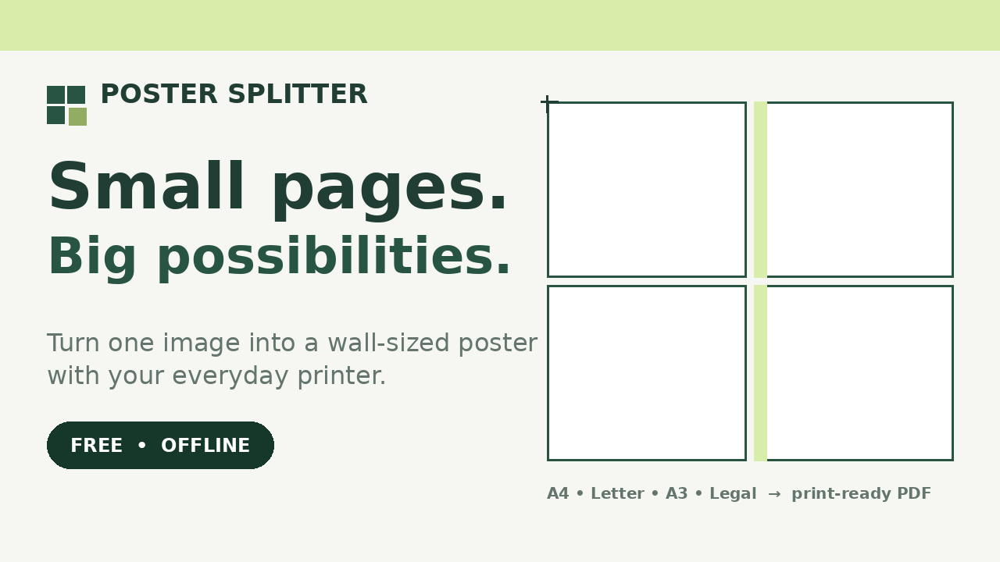

# Poster Splitter

Small pages. Big possibilities.

Turn one image into a wall-sized poster using your everyday printer. Open the single HTML file in your browser, choose a JPG, PNG or WebP image, set your finished poster size, and download a ready-to-print PDF. Print the pages at 100% / Actual size, trim at the corner marks, and tape the sheets together from behind.

Live demo: https://rsaxena3011.github.io/poster-splitter/

## What it does

- Splits one image across ordinary printer paper: A4, Letter, A3 or Legal
- Finished poster size in cm, mm or inches, with proportions locked by default
- Image rotation and horizontal flip
- Page orientation: portrait, landscape, or auto to use fewer sheets
- Overlap from 0 to 30 mm, so adjacent tiles share a repeated strip for lining up
- Printer margins from 5 to 30 mm
- PDF image quality control, cutting marks, row and column page labels
- Optional assembly guide page with a 50 mm scale check line
- Assembled poster preview and per-sheet preview, with zoom and sheet inspection
- Live sheet count and PPI estimate

## Offline and private

The whole app is one HTML file with no external libraries, no installer, no account, no server and no internet connection. Your images never leave your browser: nothing is uploaded and nothing is saved between sessions. There are no watermarks.

## How to use

1. Extract the ZIP, or open `Poster-Splitter.html` directly.
2. Choose a JPG, PNG or WebP image, drag it onto the image box, or paste an image.
3. Set the finished poster size and your printer's paper size.
4. Click Download print PDF, then print that PDF (not the app page) at 100% / Actual size, single-sided, with Fit, Shrink and any printer poster mode turned off.
5. If included, print the guide first and measure its 50 mm line with a ruler. If the length is wrong, fix the print scaling before printing the other pages.
6. Trim the white margins at the corner marks, arrange row by row, match the repeated strips, and tape from behind.

For GitHub Pages, a copy named `index.html` is included. No backend configuration is required.

## Limits

- Inputs are JPG, PNG and WebP only, up to 80 MB and 80 megapixels. PDF, SVG, GIF and HEIC inputs are not supported.
- Export uses a JPEG raster at your selected quality, with transparency flattened onto white. Larger images are reduced to at most 24 megapixels or 12,000 pixels per side, and the app reports the reduction.
- Each poster side must be between 20 mm and 5 metres, with a maximum of 200 poster sheets.
- Enlarging does not add detail. The PPI estimate uses the pixels in your image and your chosen poster size.
- This is an RGB home-print tool, not a CMYK or prepress workflow. Final colour depends on your printer and paper.
- Physical printer output has not been verified on a real printer, and browser and OS combinations beyond the tested preview have not been verified.

## License

MIT. See `LICENSE.txt`. The full guide is in `START-HERE.txt`.
